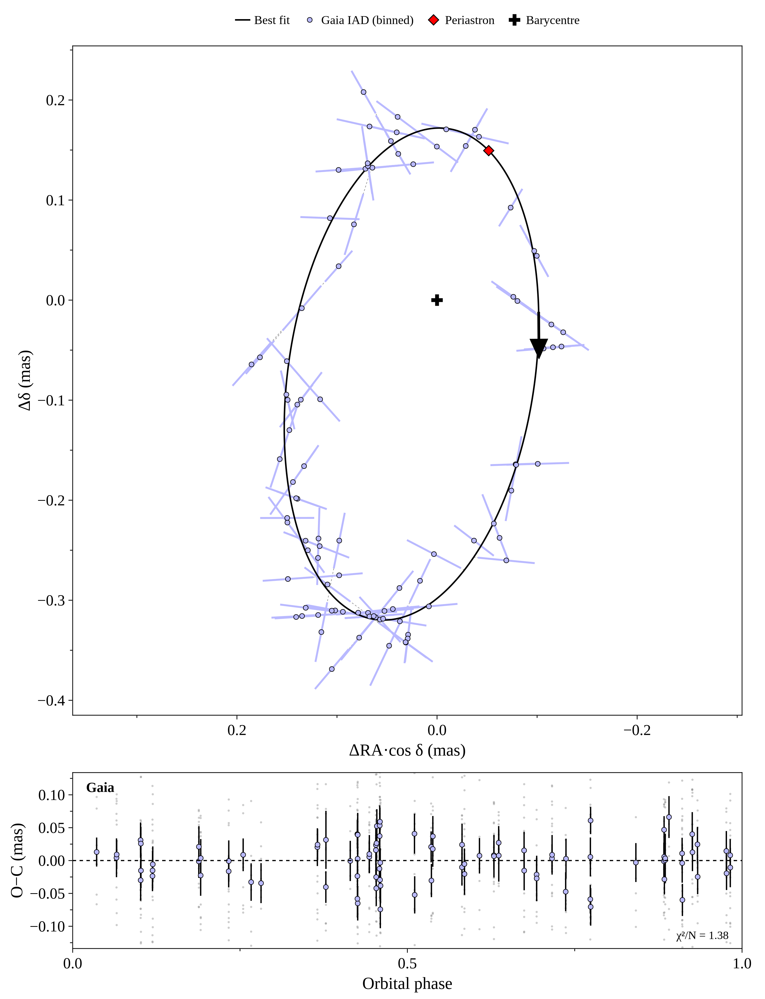
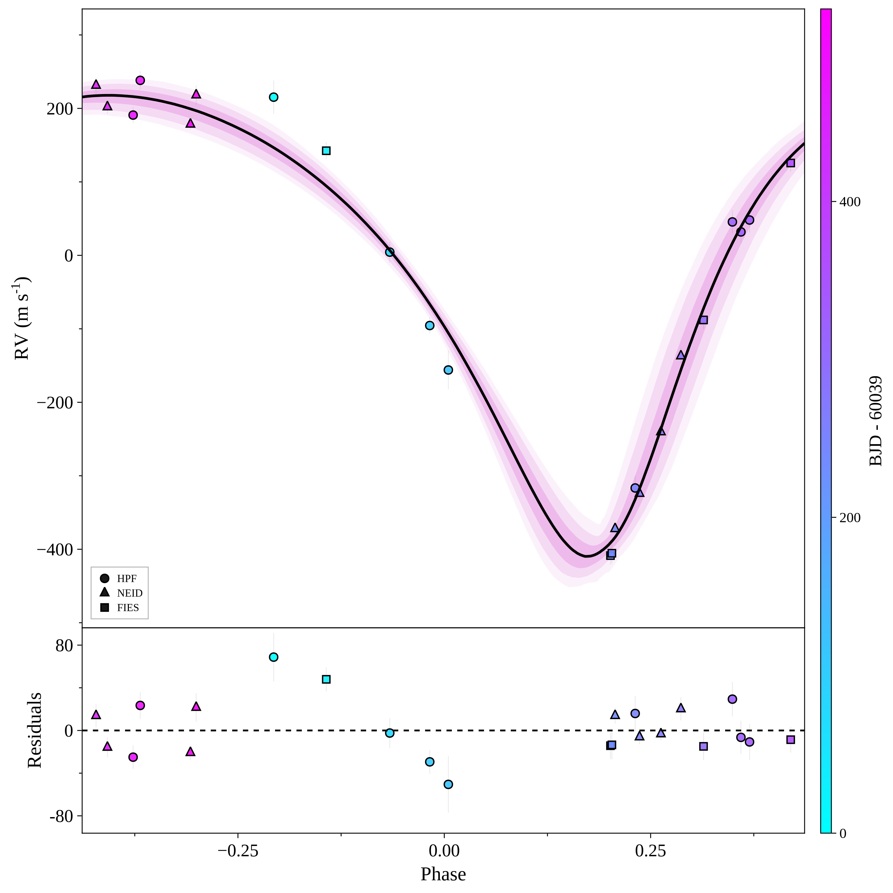
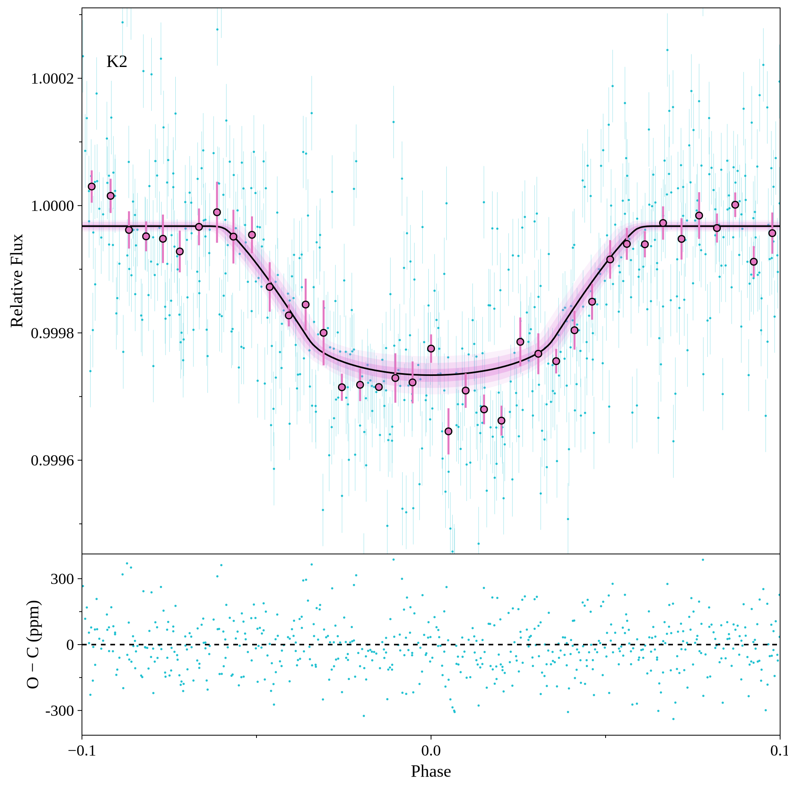
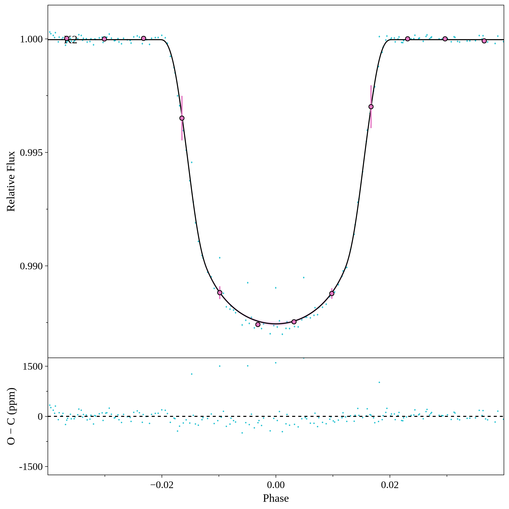
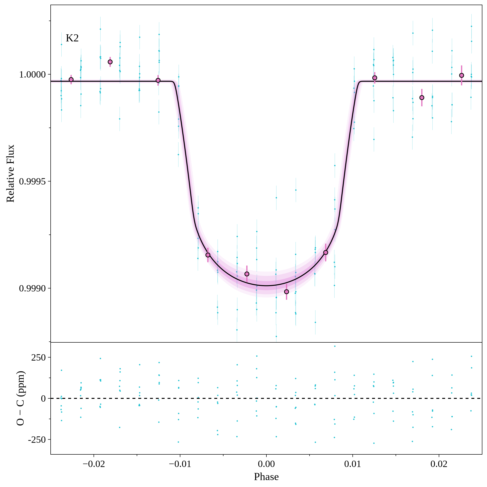
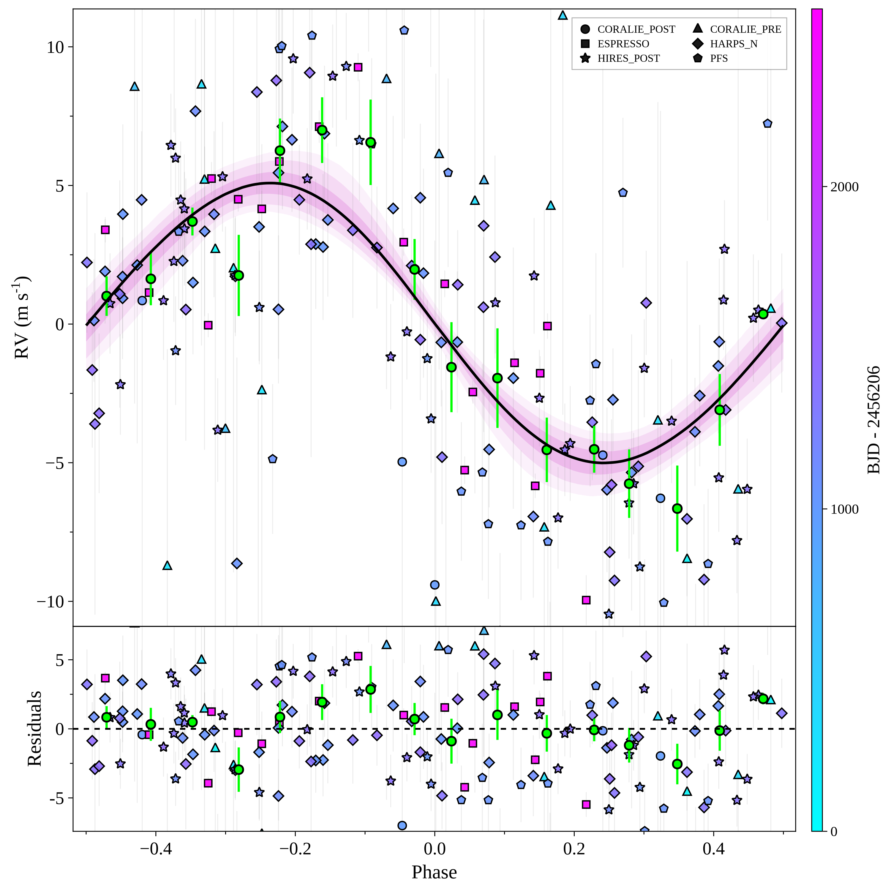
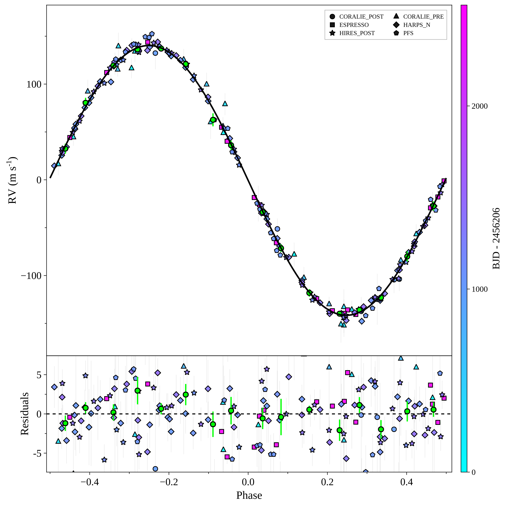
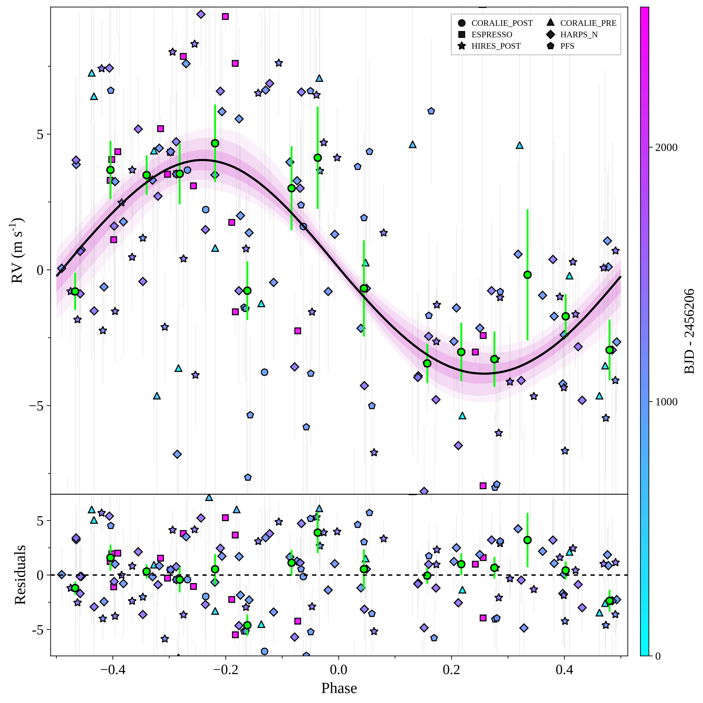
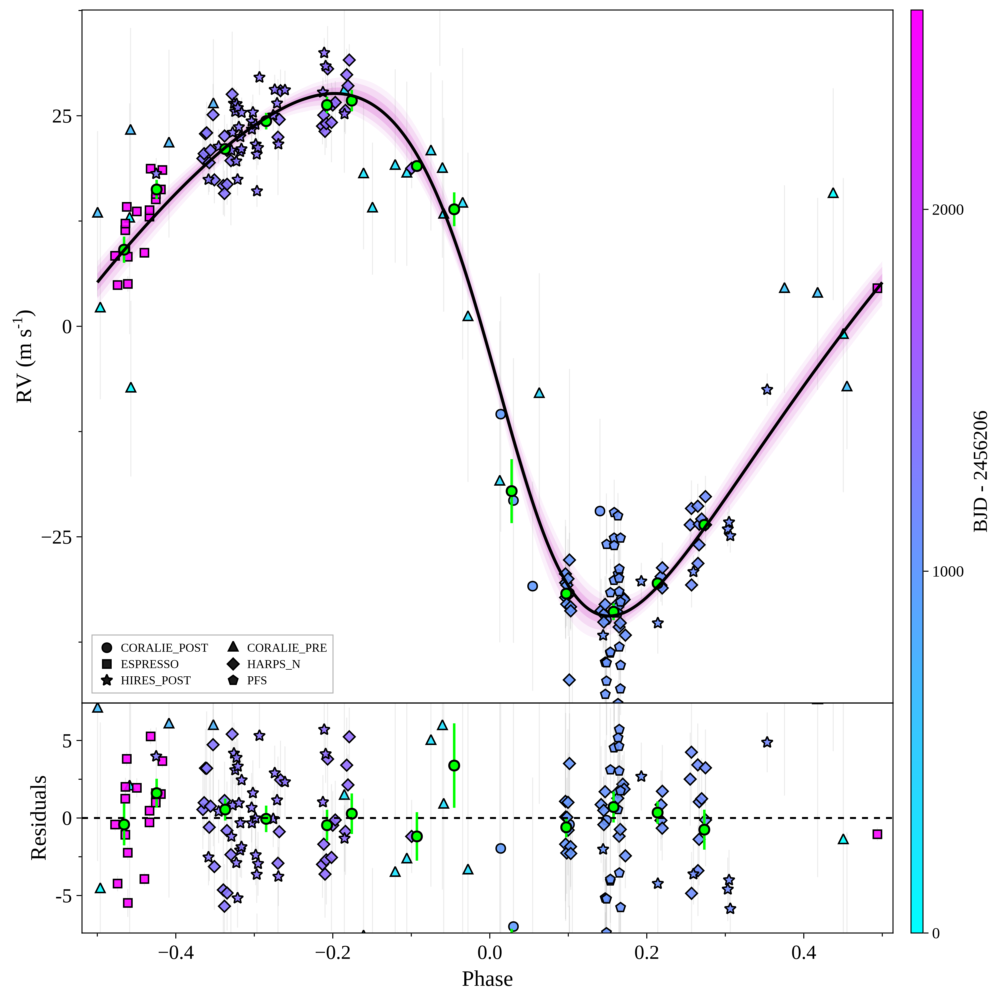

# Nereus.jl

Radial velocities, transits, absolute and relative astrometry,
Rossiter–McLaughlin, Doppler tomography and transit timing under a single
likelihood.

## What it is for

Each observable sees a different projection of the same orbit. RVs measure
K ∝ M sin i; transits measure the radius ratio, impact parameter and stellar
density; astrometry measures the photocentre orbit, a₀ ∝ M, with its
inclination and node. Fitted together they give what none gives alone: the
true mass of an RV companion, or the full architecture of a system where only
some planets transit.

Samplers share one target interface: parallel tempering (plain, ensemble,
Hamiltonian, normalising-flow coupled), nested sampling (static, importance,
dynamic), SMC, MAP, Pathfinder and OFTI, with thermodynamic-integration,
stepping-stone and hybrid evidence estimators.

## Examples

Both fits use public data only. `docs/readme/make_figures.jl` reruns them and
regenerates every figure below.

### Gaia-4 b: RV + Gaia DR4 epoch astrometry

HPF, NEID and FIES velocities (Stefansson et al. 2025) fitted jointly with the
Gaia DR4 pre-release epoch astrometry. The RVs fix the orbit's shape and
K ∝ M sin i; the DR4 along-scan abscissae fix a₀, the inclination and the node,
so the companion's true mass comes out of the joint fit.

<p align="center">
  
  
</p>

### WASP-47: RV + K2 transits, four planets

K2 Campaign 3 photometry and velocities from CORALIE, PFS, HIRES, HARPS-N and
ESPRESSO, in one model: planets e, b and d transit and are fitted in both
datasets; c, on a ~600 d orbit, is RV-only.

<p align="center">
  
  
  
</p>
<p align="center">
  
  
  
  
</p>

## Install

Julia:

```julia
using Pkg; Pkg.add(url="https://github.com/jvines/Nereus.jl")
```

Python, with no Julia installed and none required — a prebuilt runtime is
fetched on first use:

```sh
pip install astronereus
python -c "import astronereus; astronereus.install()"
```

The Python distribution is called `astronereus` because `nereus` on PyPI
belongs to an unrelated geophysics package. The Julia package, this repository
and the runtime cache all keep the name Nereus.

## Quick start

The Gaia-4 b fit above, RV plus DR4 epoch astrometry. `hpf` and `neid` are
`(t, rv, rv_err)` NamedTuples, `t` in MJD.

```julia
using Nereus

dr4 = read_gaia_epoch_votable(fetch_gaia_dr4_prerelease(), 1457486023639239296)

target = build_target(
    M_pri   = 0.644,                               # M_sun
    planets = (b = (a      = LogUniformPrior(0.3, 4.0),     # AU
                    M_sec  = LogUniformPrior(0.001, 0.05),  # M_sun
                    sesinw = UniformPrior(-1.0, 1.0),
                    secosw = UniformPrior(-1.0, 1.0),
                    Mo     = UniformPrior(0.0, 2π),
                    inc    = SinePrior(),
                    Omega  = UniformPrior(0.0, 2π)),),
    rv      = (HPF = (data = hpf,), NEID = (data = neid,)),
    iad     = dr4.iad,
    plx     = NormalPrior(13.628, 0.021),          # mas
)

chains, log_Z = sample_pt(target; n_rounds = 12)
plot_epoch_astrometry_orbit(chains, target.params, target.data; output = "out")
```

`run_job(config)` is the batch entry point, driven by a JSON/dict schema
documented in `docs/JOB_CONFIG.md`.

## Layout

The include list in `src/Nereus.jl` is a topologically sorted dependency
graph — Julia requires definition before use, so reading it top to bottom is
reading the architecture.

| directory | what it holds |
|---|---|
| `src/samplers/` | the samplers and the evidence estimators |
| `src/noise/` | correlated-noise models and their likelihoods |
| `src/astrometry/` | IAD, HGCA, GOST, Gaia DR4 epoch data, solution ladder |
| `src/diagnostics/` | PPC, LOO, detection limits, fit-health guards |
| `test/validation/` | falsifiable science gates, separate from unit tests |

## Testing

```sh
julia --project=. -e 'using Pkg; Pkg.test()'
```

`test/` holds unit and correctness tests. `test/validation/` holds the science
gates — recovery of injected signals and the reference-free symmetry
benchmarks. Those are deliberately outside the unit suite: they take minutes
to hours and answer "is the inference right", not "does the code run".

## Vendored dependencies

`vendor/NestedSamplers/` is an in-tree copy of a fork carrying `Bounds.MLFriends`
and `Proposals.HSlice`. Upstream is unmaintained; see `vendor/NestedSamplers/VENDORED.md`
for the exact commit and rationale. MIT, copyright retained.

## Licence

MIT — see `LICENSE`.
